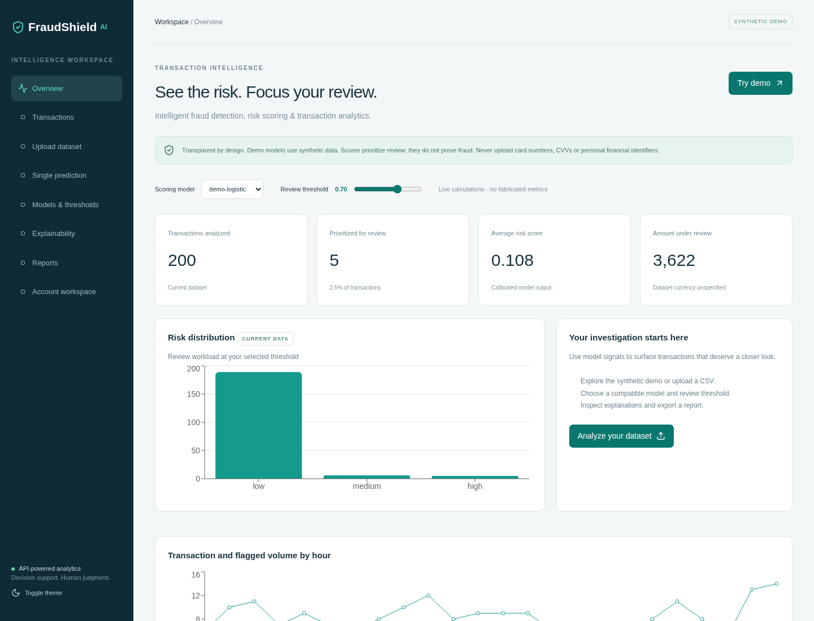
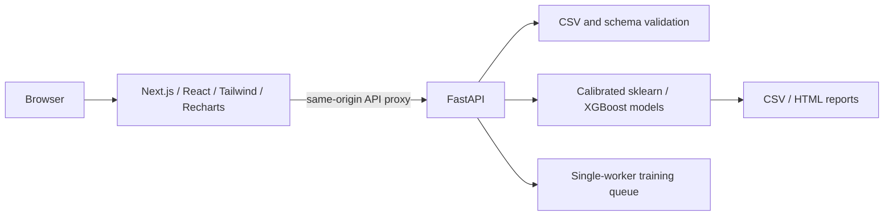

# FraudShield AI
**Intelligent fraud detection, risk scoring & transaction analytics.**

An executable Next.js + FastAPI application for exploring transaction risk, comparing calibrated models,
profiling CSV datasets and prioritizing human review. Demo predictions come from models trained at startup
on deterministic, clearly labeled synthetic data. They are not Kaggle results or proof of fraud.

## Implemented
- Responsive analyst workspace with light/dark themes, risk chart and searchable/filterable transaction queue.
- Logistic regression, random forest and XGBoost with train-only preprocessing and cross-validated calibration.
- Adjustable review thresholds, measured test metrics and validation cost curves.
- Schema-bound single/batch prediction and reference-feature occlusion explanations.
- Bounded UTF-8 CSV profiling with missing/duplicate reports and Isolation Forest anomaly percentiles.
- Single-administrator asynchronous custom training; numeric/categorical features and binary labels.
- In-memory workspace deletion; prediction CSV, summary CSV and escaped HTML investigation reports.
- OpenAPI, Python/API tests, frontend component tests, Docker Compose and GitHub Actions.

Anomaly percentiles are **not** fraud probabilities. Synthetic models accept only their declared schemas.
Public demo is anonymous; custom training is disabled unless an administrator configures WORKSPACE_TOKEN.



## Architecture


## Local development
Python 3.12 and Node 22+:
```bash
python -m venv .venv
. .venv/bin/activate
pip install -r backend/requirements-dev.txt
cd backend
python -m uvicorn app.main:app --reload
```
In another terminal:
```bash
cd frontend
npm ci
npm run dev
```
Open localhost port 3000. FastAPI documentation: backend port 8000, /docs.
The frontend uses a same-origin proxy; set API_URL before building for another backend.
Models train from synthetic records at backend startup; health reports models_ready.

For optional private training, export WORKSPACE_TOKEN before backend startup and enter it in Upload dataset.
Uploaded CSVs can be profiled regardless of schema. For inference, use the column mapping controls to map them
to the model's exact feature names. For training, remove IDs and leakage-prone columns, select a binary target
(default positive label 1) and an algorithm. Minimum 100 rows and 20 examples per class.
Custom models are private to the one administrator workspace and disappear on restart.

## Tests
```bash
cd backend && python -m pytest -q
cd ../frontend && npm test && npm run build
```

## Kaggle and local training
Download creditcard.csv yourself from [Kaggle / ULB](https://www.kaggle.com/datasets/mlg-ulb/creditcardfraud)
after reviewing the current license and access terms. No Kaggle data is redistributed here.
Do not commit downloaded data, financial records, or trained artifacts.
```bash
PYTHONPATH=backend python scripts/train.py /path/to/creditcard.csv --algorithm logistic
# Repeat with forest and xgboost for comparison.
MODEL_ARTIFACT=/absolute/path/artifacts/model.joblib WORKSPACE_TOKEN=your-local-secret \
  python -m uvicorn app.main:app --app-dir backend
```
Kaggle training requires exactly Time, V1–V28, Amount, Class.
The bounded CLI selects a stratified 10,000-row subset when necessary; it is not a full-dataset benchmark.
It writes a trusted local artifact and metrics.json; the API registers it as local-trained.
Custom CSVs can use --target is_fraud. No untrusted serialized artifact upload is supported.

## Evaluation and limitations
See [methodology](docs/methodology.md) for split, calibration and cost assumptions.
Actual test-set metrics are computed at startup and shown in Models & thresholds and GET /api/models.
No real-world performance claim is made. Screenshots and run evidence are in docs when generated.
Precision measures the fraction of flagged cases with positive labels; recall measures the fraction of positive
cases found. Accuracy alone is misleading for rare fraud. Thresholds trade review workload against missed cases.
Reference occlusion explanations are not SHAP and do not establish causation.

Not implemented: persistent PostgreSQL accounts, multi-tenant access, SHAP summaries, PDF exports,
chronological/SMOTE ablations, review-status persistence and all requested advanced charts.
The UI offers a single workspace rather than separate routed pages. This is a functional portfolio baseline,
not a certified or production-hardened financial service.

## Deployment
```bash
docker compose up --build
```
See [deployment instructions](docs/deployment.md) for Docker, hosted frontend/backend, environment variables,
TLS, memory limits and retention. Public hosting requires your hosting account and domain configuration;
no public deployment URL is claimed.

## API
GET /api/health, /api/models, /api/demo/transactions, /api/models/{id}/metrics;
POST /api/datasets/validate, /api/datasets/analyze, /api/predict, /api/predict/batch,
/api/models/train, /api/explain, /api/reports; GET /api/jobs/{id}; DELETE /api/workspace.
Reports download immediately without retaining server files.
Limits: 2 MB CSV, 10,000 rows, 64 columns, 500 text categories, one active training job and 120 requests/minute/client.
Production reverse-proxy limits are also required.

## Privacy and license
Do not upload live card numbers, CVVs or personal financial information.
No compliance certification is claimed. MIT licensed; see [LICENSE](LICENSE).

To generate a compatible synthetic CSV for the upload workflow:
```bash
PYTHONPATH=backend python scripts/make_demo.py /tmp/fraudshield-synthetic.csv
```

## Verified development run
Six backend tests and three frontend tests cover reproducibility, artifact roundtrip, invalid schemas,
private training, deletion, uploads, report exports, filtering, mapping, thresholds and error display.
The production frontend build and real Chromium smoke test were also exercised.
Recorded synthetic held-out PR-AUC: logistic 0.490, forest 0.416, XGBoost 0.469;
see [full measured metrics](docs/demo-metrics.json). These are not real-world fraud benchmarks.
