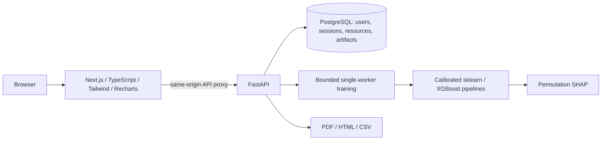

# FraudShield AI
**Intelligent fraud detection, risk scoring & transaction analytics**

A working Next.js / FastAPI application for exploring transaction risk, comparing calibrated classifiers,
investigating SHAP explanations and saving private analyses in PostgreSQL.
The anonymous demo uses reproducible **synthetic** data. No real-dataset or banking-readiness claim is made.


## Features
- Responsive light/dark analyst workspace and public landing page at /welcome.
- CSV upload/drop, preview, column mapping, missing/duplicate reports and numeric/categorical profiling.
- Logistic Regression, Random Forest and XGBoost; calibrated probabilities and validation-selected thresholds.
- Private asynchronous custom model training, persisted models, model-compatible future predictions.
- Search, risk filters, sorting, pagination, transaction details through feature explanations, review status and CSV export.
- Risk/hourly charts, separate ground-truth label counts, PR/ROC/calibration curves and confusion matrices.
- Actual permutation SHAP: individual probability contributions, sampled global importance and record-by-feature summary.
- HTML, PDF, prediction CSV and risk-summary exports. PDF includes risk chart, evaluation, thresholds and limitations.
- Registration/login/logout, Argon2id passwords, expiring sessions, CSRF and one-use password resets.
- User-owned saved datasets, investigations/report snapshots, model/resource deletion and account deletion.
- PostgreSQL / SQLAlchemy / Alembic; local SQLite fallback; three-service Docker Compose and GitHub Actions.

Public demo needs no account. Anomaly percentiles from Isolation Forest are **not** fraud probabilities.
Kaggle PCA models accept only their expected feature schema; train a separate model for unrelated data.

## Architecture


## Run locally
Python 3.12 and Node 22+:
```bash
python -m venv .venv
. .venv/bin/activate
pip install -r backend/requirements-dev.txt
cd backend
alembic upgrade head
python -m uvicorn app.main:app --reload
```
In another terminal:
```bash
cd frontend
npm ci
npm run dev
```
Open frontend port 3000; API docs are backend port 8000, /docs.
Absent DATABASE_URL uses SQLite in /tmp for local development. Do not export a blank DATABASE_URL.
For persistent PostgreSQL set DATABASE_URL to a postgresql+psycopg URL and run migrations.
Backend trains synthetic demo models at startup; /api/health reports models_ready.

## Docker
```bash
cp .env.example .env
python -c 'import secrets; print(secrets.token_hex(32))'
# Set generated value as POSTGRES_PASSWORD in ignored .env.
docker compose up --build
```
Compose runs frontend, backend and private PostgreSQL, with readiness checks and startup migrations.
Never commit passwords or production datasets. See [deployment guide](docs/deployment.md) for HTTPS, SMTP, proxy trust,
database backups, limits and hosting steps. No public website has been deployed.

## Custom dataset workflow
1. Register in Account workspace (passwords need 12–128 characters).
2. Upload a UTF-8 CSV. Inspect preview, data types, missing values, duplicates and anomaly percentiles.
3. Map names for an existing model or choose features, target, positive class and algorithm for a new model.
4. Remove identifiers and leakage-prone fields. Resolve duplicate feature rows before splitting.
5. Train with at least 100 rows and 20 examples per class. Training imputes missing features; inference rejects missing required values.
6. Inspect scores, adjust review threshold, review records and open SHAP explanations.
7. Export reports or save a private snapshot in Account workspace. Opening a snapshot restores data/model/threshold/review states.
8. Delete saved items, models (DELETE /api/models/{id}), the workspace or the account when finished.

Limits: 2 MB request/CSV, 10,000 rows, 64 columns, 500 categories per text feature, 1,000 total categories,
20 stored models/user, 50 saved resources/user, one active training job.
Per-instance rate limits are 120 general requests/minute and 10 authentication writes/minute per observed client.
Production ingress must provide distributed abuse controls and trustworthy client identity.

Synthetic CSV for a local upload test:
```bash
PYTHONPATH=backend python scripts/make_demo.py /tmp/fraudshield-synthetic.csv
```

## Kaggle and ML research
Dataset: [ULB Credit Card Fraud Detection](https://www.kaggle.com/datasets/mlg-ulb/creditcardfraud).
Review its access and redistribution terms. No Kaggle data is bundled.
Install the supported Kaggle CLI, configure your own credentials securely, then:
```bash
python scripts/download_kaggle.py --output data/kaggle
PYTHONPATH=backend python scripts/train.py data/kaggle/creditcard.csv --target Class --algorithm logistic
```
Manual download is also documented. Expected columns: Time, V1–V28, Amount, Class.
The bounded training CLI drops exact duplicate rows and selects a deterministic stratified 10,000-row subset
when needed; it is **not** a full-dataset benchmark.
Artifacts and metrics are local/ignored. Administrators may load a trusted artifact using MODEL_ARTIFACT
with the optional WORKSPACE_TOKEN capability. No serialized artifact upload endpoint exists.

[Methodology and reproduction](docs/methodology.md) describes:
- Train-only preprocessing and calibration; explicit stratified and chronological partitions.
- Baseline/class-weight/SMOTE comparisons, with SMOTE inside training folds.
- Optuna search using validation PR-AUC, threshold cost optimization and held-out evaluation.
- PR/ROC/calibration curves, recall at fixed precision, precision at review budget and cost sensitivity.
- Fixed held-out distribution-shift stress and SHAP feature importance comparisons.

[15 measured synthetic experiment runs](docs/synthetic-experiments.json) include data hash, configuration, results and limitations.
Example PR-AUC values for class-weighted tuned variants: Logistic 0.488, Forest 0.446, XGBoost 0.463.
Chronological defaults: Logistic 0.571, Forest 0.581, XGBoost 0.591 (consult the JSON for exact values).
These use different experimental configurations from the [earlier demo run](docs/demo-metrics.json).
All are synthetic results, not Kaggle evaluation. Real dataset access was blocked by the cloud proxy and absent Kaggle credentials.

SHAP wraps the complete calibrated pipeline; contributions sum with a base value to the model probability.
Global plots summarize at most 20 submitted records against a 20-row training background, not the entire population.
Attributions are approximate, background-dependent and noncausal. V1–V28 have no invented original meanings.

## Tests and CI
```bash
cd backend
python -m pytest -q
cd ../frontend
npm test
npm run build
```
Backend tests exercise preprocessing/fold isolation, duplicate leakage, Kaggle fixtures, three algorithms,
SMOTE/chronological protocols, probability/schema validation, artifact roundtrip, accounts, authorization,
sessions/CSRF/reset, persistent training, uploads, SHAP additivity, PDF content and exports.
Frontend tests exercise dashboard controls, upload/mapping, errors and account workflows.
`scripts/browser_smoke.py` tests the anonymous demo; `scripts/workspace_e2e.py` tests the authenticated workflow in Chromium.
GitHub Actions runs PostgreSQL migrations, backend tests, frontend tests and the production build.
See [implementation status](docs/IMPLEMENTATION_STATUS.md) for exact latest test results and external blockers.

## API
FastAPI OpenAPI at /docs documents all schemas.
- Public: GET /api/health, /api/demo/transactions, /api/models; POST /api/predict[/batch], /api/explain, /api/reports, /api/datasets/analyze and /validate.
- Auth: POST /api/auth/register, /login, /logout, /forgot-password, /reset-password; GET /api/auth/me; DELETE /api/auth/account.
- Workspace: POST /api/models/train; GET /api/jobs/{id}; DELETE /api/models/{id}, /api/workspace.
- Saved items: GET/POST /api/workspace/resources; GET/DELETE /api/workspace/resources/{id}.
Private models and resources require their owning session. Cookie-authenticated writes require X-CSRF-Token.

## Limitations and production prerequisites
No public deployment, real Kaggle benchmark or live email delivery is verified.
Configure hosting, PostgreSQL TLS/backups, HTTPS, Secure cookies and SMTP before deployment.
Add email verification, distributed rate limits, a durable worker queue and operational security review
before broad public registration or horizontal scaling. One API worker is currently required.
Running jobs do not survive restarts; completed user models and saved resources do.
Saved report snapshots reference their model; deleting it can prevent re-export.
Training is bounded to 10,000 rows; experiment search is deliberately small by default.
No PCI DSS, banking or regulated-production certification is claimed. Never upload PANs, CVVs or personal financial identifiers.
The application supports human review; high risk is not proof of fraud.

## License
[MIT](LICENSE). Dataset licenses and access conditions are separate.
